# Manual de Usuario --- Sistema de Gestión para Clínica Veterinaria

> **Versión:** 1.0 (Producción)  
> **Plataforma:** Windows Desktop (.NET 10 Windows Forms + SQL Server)  
> **Organización de la guía:** Paso a paso según el **Rol de Usuario** (*Administrador*, *Secretario* y *Veterinario*).

---

## Tabla de Contenidos

1. [Introducción y Acceso al Sistema (Login)](#1-introducción-y-acceso-al-sistema-login)
2. [Guía Paso a Paso --- Rol Administrador](#2-guía-paso-a-paso-----rol-administrador)
   - [2.1. Panel Principal del Administrador](#21-panel-principal-del-administrador)
   - [2.2. Gestión de Usuarios y Permisos](#22-gestión-de-usuarios-y-permisos)
   - [2.3. Padrón General de Propietarios](#23-padrón-general-de-propietarios)
   - [2.4. Padrón General de Mascotas](#24-padrón-general-de-mascotas)
   - [2.5. Reportes Estadísticos e Impresión](#25-reportes-estadísticos-e-impresión)
   - [2.6. Copias de Seguridad (Backup) y Restauración con Doble Firma](#26-copias-de-seguridad-backup-y-restauración-con-doble-firma)
3. [Guía Paso a Paso --- Rol Secretario (Recepción y Caja)](#3-guía-paso-a-paso-----rol-secretario-recepción-y-caja)
   - [3.1. Panel Principal de Secretaría](#31-panel-principal-de-secretaría)
   - [3.2. Recepción: Alta y Gestión de Propietarios](#32-recepción-alta-y-gestión-de-propietarios)
   - [3.3. Recepción: Alta de Pacientes (Mascotas), Especies y Razas](#33-recepción-alta-de-pacientes-mascotas-especies-y-razas)
   - [3.4. Gestión de Cobros, Calculadora de Vuelto y Emisión de Ticket](#34-gestión-de-cobros-calculadora-de-vuelto-y-emisión-de-ticket)
   - [3.5. Reportes Operativos de Secretaría](#35-reportes-operativos-de-secretaría)
4. [Guía Paso a Paso --- Rol Veterinario (Atención Clínica)](#4-guía-paso-a-paso-----rol-veterinario-atención-clínica)
   - [4.1. Panel Principal Clínico](#41-panel-principal-clínico)
   - [4.2. Registro de Consultas Clínicas y Signos Vitales](#42-registro-de-consultas-clínicas-y-signos-vitales)
   - [4.3. Aplicación de Tratamientos y Gestión de Catálogo](#43-aplicación-de-tratamientos-y-gestión-de-catálogo)
   - [4.4. Aplicación de Vacunas y Calendario de Dosis](#44-aplicación-de-vacunas-y-calendario-de-dosis)
   - [4.5. Ficha Médica Integral e Impresión de Historial Clínico](#45-ficha-médica-integral-e-impresión-de-historial-clínico)
   - [4.6. Reportes Clínicos Veterinarios](#46-reportes-clínicos-veterinarios)

---

## 1. Introducción y Acceso al Sistema (Login)

Al iniciar la aplicación se presenta la ventana de **Inicio de Sesión**, la cual redirige automáticamente al usuario hacia el panel correspondiente a su perfil operativo (*Administrador*, *Secretario* o *Veterinario*).

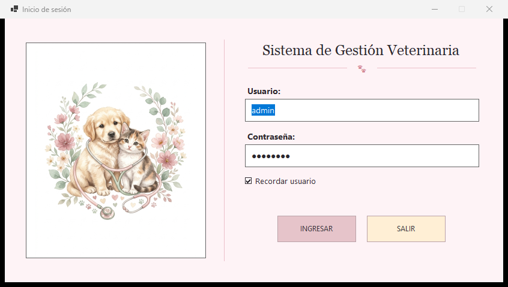

### Paso a paso para iniciar sesión:
1. **Ingreso de credenciales:**
   - Complete el campo **Usuario** (por ejemplo: `admin`, `secretario` o `vet`).
   - Complete el campo **Contraseña**.
2. **Recordar usuario (Opcional):** Marque la casilla **"Recordar usuario"** si desea conservar su nombre de cuenta para el próximo inicio de la aplicación en este equipo.
3. Presione el botón **`INGRESAR`** (o la tecla `Enter`). Para cerrar la aplicación sin autenticarse, presione **`SALIR`**.

> **Nota de seguridad:** Si una cuenta se encuentra dada de baja (`Inactivo`), el sistema bloqueará el ingreso e informará en pantalla que debe contactar al Administrador.

---

## 2. Guía Paso a Paso --- Rol Administrador

El **Administrador** posee acceso total a la configuración de cuentas de usuario, auditoría del padrón de propietarios y mascotas, tableros gerenciales y resguardo/restauración de la base de datos.

### 2.1. Panel Principal del Administrador

Tras autenticarse con una cuenta de rol *Administrador*, se despliega el menú principal de administración:

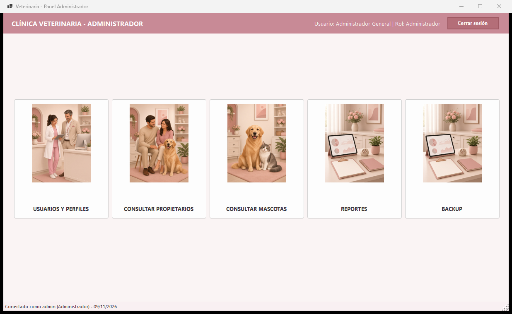

Desde aquí puede acceder a cada módulo haciendo clic en las tarjetas centrales (**`USUARIOS Y PERFILES`**, **`CONSULTAR PROPIETARIOS`**, **`CONSULTAR MASCOTAS`**, **`REPORTES`** y **`BACKUP`**) o cerrar su sesión activa con el botón superior derecho **`Cerrar sesión`**.

---

### 2.2. Gestión de Usuarios y Permisos

Permite administrar las cuentas del personal de la clínica, asignar perfiles y gestionar el estado de cada usuario.

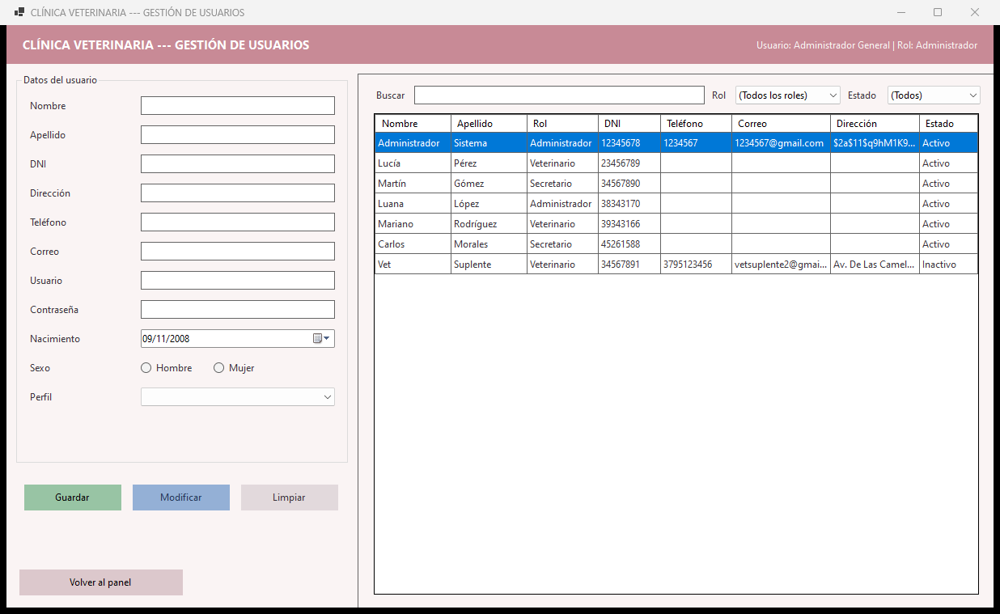

#### A. Cómo registrar un nuevo usuario:
1. En el panel izquierdo **"Datos del usuario"**, complete los campos requeridos:
   - **Nombre** y **Apellido** (solo letras y espacios).
   - **DNI** (7 u 8 dígitos numéricos, único en el sistema), **Dirección**, **Teléfono** y **Correo** (`usuario@dominio.com`).
   - **Usuario** (nombre de cuenta único) y **Contraseña** (mínimo 6 caracteres).
   - **Nacimiento**, **Sexo** (`Hombre` / `Mujer`) y **Perfil** (`Administrador`, `Secretario`, `Veterinario` o `Gerente`).
2. Haga clic en **`Guardar`**.

#### B. Cómo consultar, modificar o cambiar el estado de un usuario:
1. Utilice el cuadro **Buscar** o los filtros superiores por **Rol** y **Estado** (`Activos`, `Inactivos`, `Todos`) para localizar al usuario en la grilla derecha.
2. Seleccione el usuario en la tabla y presione **`Modificar`** para abrir la ventana de edición donde podrá actualizar sus datos, perfil o estado (`Activo` / `Inactivo`).
   - *Regla de protección:* El sistema impide que el Administrador en sesión desactive su propia cuenta activa.

---

### 2.3. Padrón General de Propietarios

Permite al Administrador consultar y auditar el padrón completo de propietarios y visualizar las mascotas asociadas a cada titular.

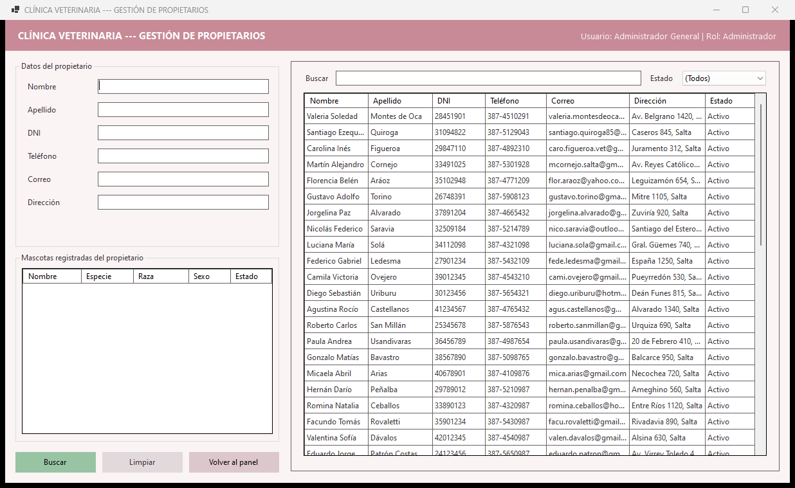

#### Paso a paso:
1. **Búsqueda y filtrado rápido:** Utilice el cuadro superior **Buscar** en el panel derecho o filtre por **Estado** (`Todos`, `Activos`, `Inactivos`), o bien complete los criterios del panel izquierdo (**Datos del propietario**) y presione **`Buscar`**.
2. **Inspección de ficha y mascotas vinculadas:** Al seleccionar cualquier propietario en la grilla principal, sus datos personales se cargan a la izquierda y en la tabla inferior **"Mascotas registradas del propietario"** se listan todos sus pacientes asociados (*Nombre*, *Especie*, *Raza*, *Sexo* y *Estado*).
3. Presione **`Limpiar`** para restablecer los filtros o **`Volver al panel`** para regresar al menú principal.

---

### 2.4. Padrón General de Mascotas

Brinda al Administrador visibilidad integral sobre todos los pacientes registrados en la clínica, permitiendo filtrar por especie, raza, sexo y estado.

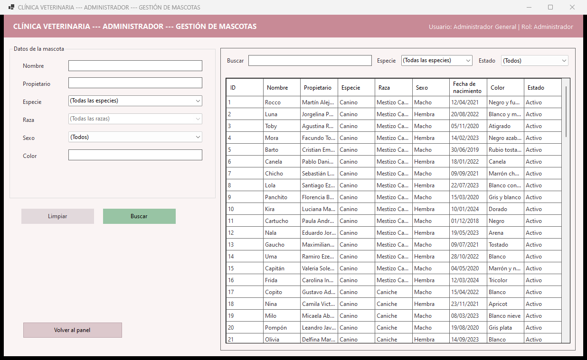

#### Paso a paso:
1. **Filtrado combinado:** En el panel izquierdo **"Datos de la mascota"**, puede filtrar por **Nombre**, **Propietario**, **Especie**, **Raza**, **Sexo** o **Color** y presionar **`Buscar`**.
2. **Búsqueda directa en grilla:** En el panel derecho puede escribir directamente en el cuadro **Buscar** o filtrar al instante mediante los desplegables superiores de **Especie** y **Estado**.
3. Use **`Limpiar`** para reiniciar los criterios de consulta o **`Volver al panel`** para salir del módulo.

---

### 2.5. Reportes Estadísticos e Impresión

El módulo de **Reportes** del Administrador genera gráficos comparativos de evolución y distribución porcentual, además de tablas detalladas exportables a PDF.

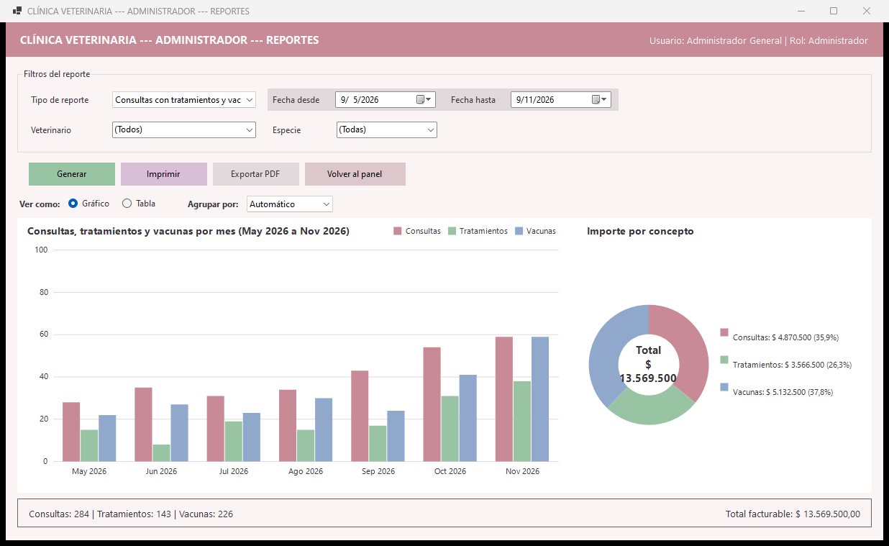

#### Paso a paso para generar e imprimir un reporte:
1. En **"Filtros del reporte"**, seleccione el **Tipo de reporte** (por ejemplo: *Consultas con tratamientos y vacunas*), el rango (**Fecha desde** / **Fecha hasta**), **Veterinario** y **Especie**.
2. Presione el botón **`Generar`**.
3. El sistema actualizará automáticamente:
   - El **gráfico de barras de evolución** y el **gráfico de anillo de importe por concepto** (vista `Gráfico`), o el desglose completo (vista `Tabla`).
   - El resumen inferior con totales de consultas, tratamientos, vacunas y **Total facturable**.
4. Presione **`Imprimir`** o **`Exportar PDF`** para obtener el documento en formato A4.

---

### 2.6. Copias de Seguridad (Backup) y Restauración con Doble Firma

Módulo exclusivo del Administrador para resguardar la base de datos SQL Server en archivos `.bak` y restaurar copias previas bajo protocolo de seguridad de **Doble Firma**.

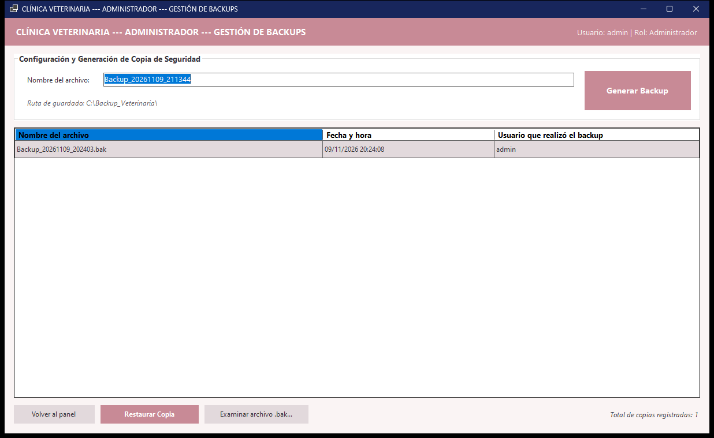

#### A. Cómo generar un Backup (`.bak`):
1. El sistema sugiere automáticamente un **Nombre del archivo** con marca de tiempo (`Backup_AAAAMMDD_HHMMSS`). Puede conservarlo o ingresar un nombre personalizado.
2. Haga clic en **`Generar Backup`**.
3. El archivo físico se guardará en `C:\Backup_Veterinaria\` y el registro aparecerá de inmediato en la tabla histórica con fecha, hora y usuario responsable.

#### B. Cómo restaurar una Copia de Seguridad (Protocolo de Doble Firma):
1. Seleccione una copia en la tabla histórica (o utilice **`Examinar archivo .bak...`** para elegir un archivo local) y presione **`Restaurar Copia`**.
2. Se abrirá el diálogo de **Autorización de Doble Firma**, el cual exige validar simultáneamente las credenciales de un **Administrador** y de un **Gerente** activos.
3. Una vez autorizada la operación, el sistema restaura la base de datos y reinicia la sesión para aplicar el estado recuperado.

---

## 3. Guía Paso a Paso --- Rol Secretario (Recepción y Caja)

El rol **Secretario** está diseñado para la operatoria diaria de recepción de clientes, empadronamiento de pacientes, facturación en caja y emisión de comprobantes.

### 3.1. Panel Principal de Secretaría

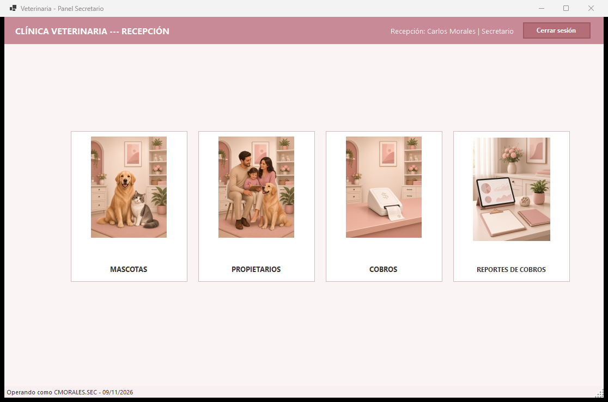

Permite el acceso directo a los módulos operativos de recepción: **`MASCOTAS`**, **`PROPIETARIOS`**, **`COBROS`** y **`REPORTES DE COBROS`**.

---

### 3.2. Recepción: Alta y Gestión de Propietarios

Cuando un cliente asiste por primera vez a la clínica, el Secretario lo registra y administra desde el padrón de propietarios:

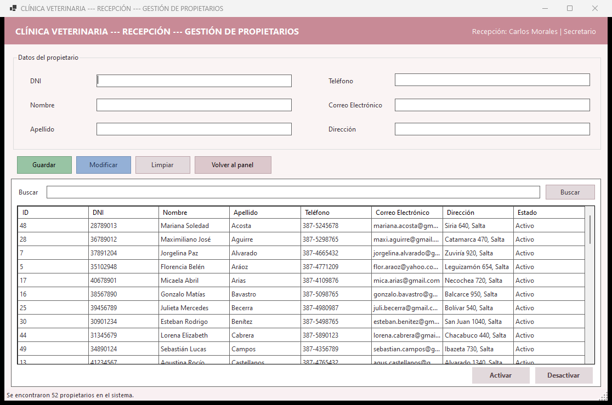

#### Paso a paso:
1. **Verificar existencia:** Utilice el cuadro **Buscar** (por DNI, nombre o apellido) y presione **`Buscar`** para comprobar si el cliente ya está registrado.
2. **Registrar nuevo propietario:** Complete **DNI**, **Nombre**, **Apellido**, **Teléfono**, **Correo Electrónico** y **Dirección** en el bloque superior **"Datos del propietario"** y haga clic en **`Guardar`**.
3. **Modificar o Activar/Desactivar:** Seleccione una fila en la tabla, edite los campos necesarios y presione **`Modificar`**, o utilice los botones inferiores **`Activar`** / **`Desactivar`** para cambiar su estado en el padrón.

---

### 3.3. Recepción: Alta de Pacientes (Mascotas), Especies y Razas

Una vez registrado el propietario, vincule su mascota desde el módulo **Gestión de Mascotas**:

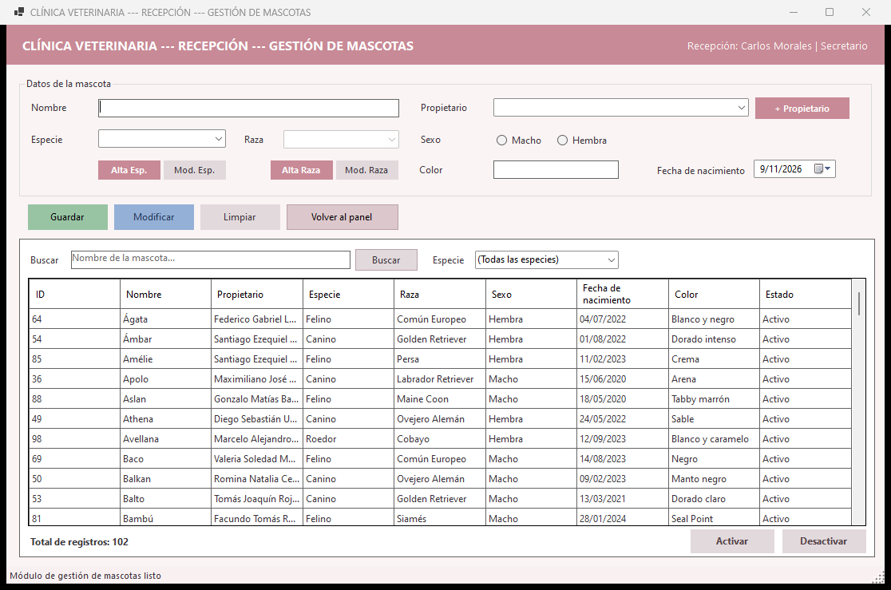

#### Paso a paso:
1. En **"Datos de la mascota"**, ingrese el **Nombre** del paciente y seleccione el **Propietario** en el desplegable buscable (o presione **`+ Propietario`** para dar de alta un dueño nuevo sin salir de la pantalla).
2. Seleccione la **Especie** y luego la **Raza** (las razas se filtran automáticamente según la especie elegida).
   - *Catálogos satélite:* Si necesita agregar o editar una especie o raza, utilice los botones **`Alta Esp.`**, **`Mod. Esp.`**, **`Alta Raza`** y **`Mod. Raza`**.
3. Indique el **Sexo** (`Macho` / `Hembra`), **Color** y **Fecha de nacimiento**, y presione **`Guardar`**.

---

### 3.4. Gestión de Cobros, Calculadora de Vuelto y Emisión de Ticket

Una vez que el Veterinario finaliza la atención clínica, la consulta aparece disponible en el módulo de **Cobros** de Recepción.

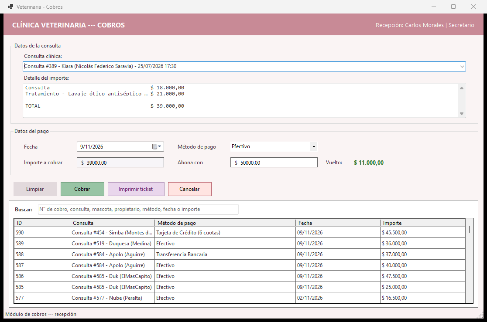

#### Paso a paso para registrar un cobro:
1. **Seleccionar la consulta:** En el desplegable superior **Consulta clínica**, elija la atención pendiente de cobro. En **Detalle del importe** se mostrará el desglose completo (*Consulta*, *Tratamientos* y *Vacunas*) junto con el **`TOTAL`**.
2. **Importe a cobrar (Solo lectura):** El campo **Importe a cobrar** se autocompleta con el monto total de la consulta y permanece bloqueado, ya que cada consulta se abona en un único pago por el total.
3. **Seleccionar el Método de pago:**
   - **Si elige `Efectivo`:** Se habilita el campo **`Abona con`**. Ingrese el monto entregado por el cliente (mayor o igual al importe a cobrar); el sistema calculará automáticamente el **`Vuelto`** en color verde y habilitará el botón **`Cobrar`**.
   - **Si elige `Tarjeta de Crédito`:** Se habilita el selector de cuotas (`1`, `3`, `6` o `12` cuotas).
   - **Si elige `Tarjeta de Débito` o `Transferencia Bancaria`:** El botón **`Cobrar`** se habilita directamente por el importe exacto.
4. **Registrar e imprimir ticket:** Presione **`Cobrar`**. Se emitirá en pantalla el **Ticket / Comprobante de Pago** con el detalle de servicios, medio de pago, monto abonado y vuelto entregado, listo para imprimir en formato térmico (80 mm) o reimprimir desde el historial inferior con **`Imprimir ticket`**.

---

### 3.5. Reportes Operativos de Secretaría

Permite a Recepción consultar los cobros del período por método de pago y su evolución temporal:

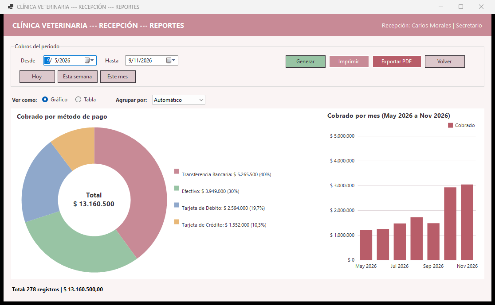

#### Paso a paso:
1. Seleccione el rango de fechas (**Desde** y **Hasta**) o utilice los accesos rápidos **`Hoy`**, **`Esta semana`** o **`Este mes`**, y presione **`Generar`**.
2. Visualice la distribución en el gráfico de anillo (**Cobrado por método de pago**) y en el gráfico de barras (**Cobrado por mes**), o cambie a la vista **`Tabla`**.
3. Utilice **`Imprimir`** o **`Exportar PDF`** para emitir el arqueo de caja del período.

---

## 4. Guía Paso a Paso --- Rol Veterinario (Atención Clínica)

El **Veterinario** dispone de las herramientas clínicas para registrar consultas, controlar signos vitales, aplicar tratamientos y vacunas con descuento automático de stock, y emitir fichas médicas completas.

### 4.1. Panel Principal Clínico

Desde su panel principal puede dirigirse a **`CONSULTAS`**, **`HISTORIAL CLÍNICO`**, **`TRATAMIENTOS`**, **`VACUNACIÓN`** y **`REPORTES DE CONSULTAS`**.

---

### 4.2. Registro de Consultas Clínicas y Signos Vitales

Permite asentar una nueva atención médica y consultar simultáneamente el historial clínico previo en la grilla inferior.

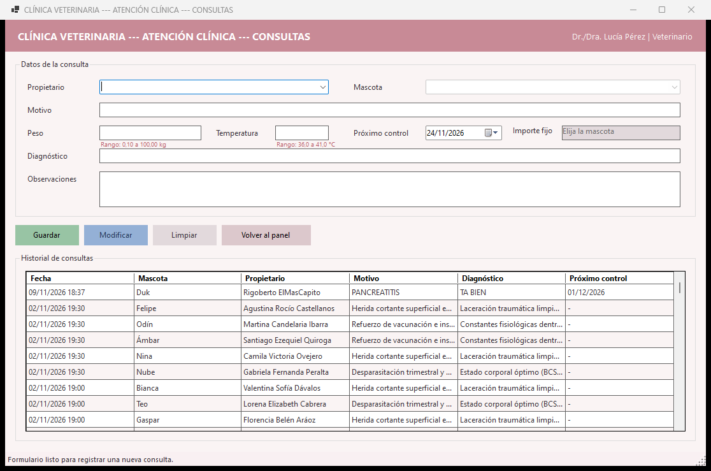

#### Paso a paso para registrar una consulta:
1. **Seleccionar Propietario y Mascota:** Elija el **Propietario** y luego la **Mascota** en los selectores buscables superiores (el campo **Importe fijo** mostrará el arancel base según la especie).
2. **Completar evaluación clínica:** Ingrese el **Motivo** de la consulta, **Diagnóstico** y **Observaciones**.
3. **Cargar Signos Vitales con validación de rango asistida:**
   - **Peso:** Rango aceptado de **`0,10 a 100,00 kg`** (indicado en la subleyenda roja debajo del campo).
   - **Temperatura:** Rango aceptado de **`35,0 a 43,0 °C`** (indicado en la subleyenda roja debajo del campo).
   - *Nota:* Si ingresa un valor fuera del rango fisiológico permitido, al abandonar el campo el sistema lo limpiará automáticamente para evitar errores de registro.
4. Indique la fecha de **Próximo control** y presione **`Guardar`** (o seleccione una fila del historial inferior y presione **`Modificar`** para actualizarla).

---

### 4.3. Aplicación de Tratamientos y Gestión de Catálogo

Permite vincular prácticas médicas, cirugías o insumos a una consulta activa, descontando automáticamente las unidades del inventario.

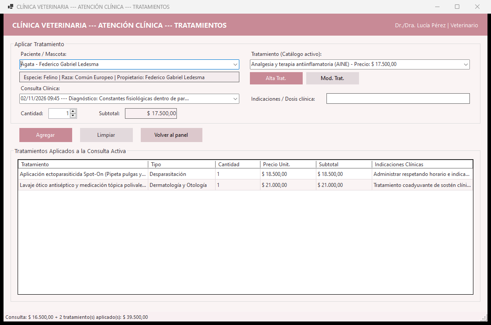

#### Paso a paso:
1. **Seleccionar Paciente y Consulta:** Elija el **Paciente / Mascota** y la **Consulta Clínica** activa a la cual desea asociar la práctica.
2. **Elegir Tratamiento y Cantidad:** Seleccione el ítem en **Tratamiento (Catálogo activo)**, indique la **Cantidad** (el **Subtotal** se calcula automáticamente) y complete las **Indicaciones / Dosis clínica**.
3. **Registrar:** Presione **`Agregar`**. El tratamiento se sumará a la grilla **"Tratamientos Aplicados a la Consulta Activa"**, descontando el stock y actualizando el total acumulado al pie para su cobro en Recepción.
4. **Gestión de Catálogo:** Utilice los botones **`Alta Trat.`** y **`Mod. Trat.`** para incorporar nuevos tratamientos al catálogo o actualizar su nombre, descripción y precio (el stock inicial permanece protegido en la edición para resguardar la trazabilidad).

---

### 4.4. Aplicación de Vacunas y Calendario de Dosis

Permite registrar las inmunizaciones suministradas al paciente y programar la fecha de su próximo refuerzo.

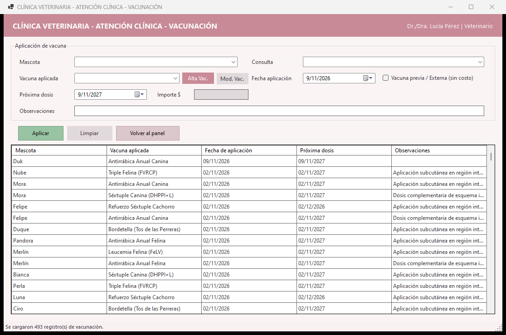

#### Paso a paso:
1. **Datos de la aplicación:** Seleccione la **Mascota**, vincule opcionalmente la **Consulta** y elija la **Vacuna aplicada** del catálogo activo.
   - Si se trata de una inmunización externa informada por el propietario, marque **"Vacuna previa / Externa (sin costo)"**.
2. **Fechas y Observaciones:** Verifique la **Fecha aplicación**, defina la fecha de **Próxima dosis** y agregue las **Observaciones** clínicas.
3. **Confirmar:** Presione **`Aplicar`**. El sistema descontará el stock correspondiente y agregará el registro a la tabla inferior.
4. **Administración del catálogo:** Utilice los botones **`Alta Vac.`** y **`Mod. Vac.`** para dar de alta o editar vacunas del catálogo.

---

### 4.5. Ficha Médica Integral e Impresión de Historial Clínico

Consolida toda la historia clínica de una mascota (consultas, diagnósticos, signos vitales, tratamientos y vacunas aplicadas) en una única vista autoajustable e imprimible.

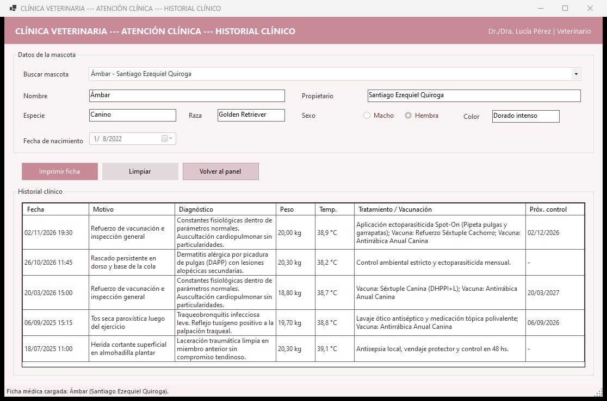

#### Paso a paso:
1. Seleccione el paciente en el buscador superior **Buscar mascota**.
2. En **Datos de la mascota** se completarán automáticamente su filiación (*Nombre*, *Especie*, *Raza*, *Fecha de nacimiento*, *Propietario*, *Sexo* y *Color*).
3. En la tabla **Historial clínico**, las filas ajustan automáticamente su altura para mostrar el texto completo sin recortes en **Motivo**, **Diagnóstico**, **Peso**, **Temp.**, **Tratamiento / Vacunación** y **Próx. control**.
4. Presione **`Imprimir ficha`** para abrir la vista previa de impresión en hoja A4 multi-línea lista para entregar al cliente o guardar como PDF.

---

### 4.6. Reportes Clínicos Veterinarios

Permite al profesional analizar sus consultas atendidas por período, distribución por especie, o vacunas y tratamientos aplicados, con exportación directa a PDF:

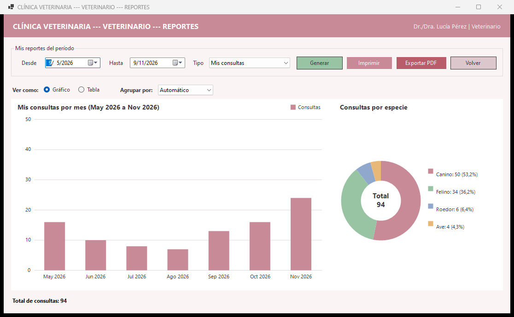

#### Paso a paso:
1. Defina el período (**Desde** y **Hasta**), elija el **Tipo** de reporte (*Mis consultas* o *Vacunas y tratamientos*) y presione **`Generar`**.
2. Analice la evolución mensual y la distribución por especie en modo **`Gráfico`** o alterne a la vista **`Tabla`**.
3. Presione **`Imprimir`** o **`Exportar PDF`** para generar el informe clínico en hoja A4.

---
*Documento generado con capturas reales del entorno de producción --- Sistema de Gestión Veterinaria.*
