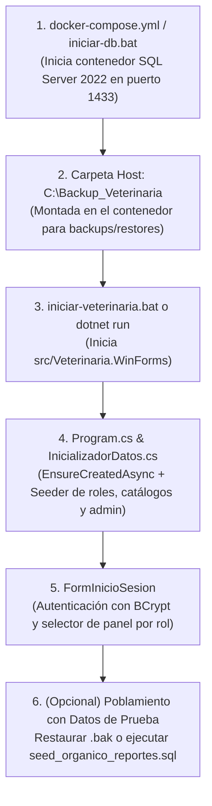

# Sistema de Gestión Clínica Veterinaria

Sistema integral de gestión de clínica veterinaria desarrollado sobre **.NET 10 (C# / Windows Forms)** y **Microsoft SQL Server 2022**, con una arquitectura en capas desacopladas, inyección de dependencias nativa, control de stock de insumos clínicos, módulo de cobros y facturación, reportes analíticos con gráficos y gestión de copias de seguridad con control de acceso por doble factor (perfil Administrador - Credenciales del Gerente).

---

## Índice
1. [Requisitos Previos](#requisitos-previos)
2. [Lanzamiento Rápido (Sin Visual Studio)](#lanzamiento-rápido-sin-visual-studio)
3. [Flujo y Orden de Ejecución de Archivos](#flujo-y-orden-de-ejecución-de-archivos)
4. [Arquitectura del Proyecto](#arquitectura-del-proyecto)
5. [Credenciales de Acceso por Rol](#credenciales-de-acceso-por-rol)
6. [Configuración de Base de Datos y Conexión](#configuración-de-base-de-datos-y-conexión)
7. [Scripts y Archivos Clave del Repositorio](#scripts-y-archivos-clave-del-repositorio)

---

## Requisitos Previos

Para compilar y ejecutar el proyecto no se requiere Visual Studio completo; únicamente es necesario:

* **Sistema Operativo:** Windows 10 o Windows 11 (64-bit).
* **.NET SDK:** Versión **10.0** o superior ([Descargar .NET SDK](https://dotnet.microsoft.com/download/dotnet/10.0)).
* **Motor de Base de Datos:**
  * **Opción recomendada:** [Docker Desktop para Windows](https://www.docker.com/products/docker-desktop/) (levanta SQL Server 2022 en un contenedor aislado con un solo comando).
  * **Opción alternativa:** Instancia local de SQL Server / SQL Express escuchando en el puerto estándar `1433`.

---

## Lanzamiento Rápido (Sin Visual Studio)

### Método 1: Lanzador automatizado (`.bat`) - *Recomendado*
Hacer doble clic sobre el archivo:
```bat
iniciar-veterinaria.bat
```
Este script realiza automáticamente las siguientes acciones:
1. Verifica que el SDK de .NET esté instalado en el sistema.
2. Crea en el equipo host la carpeta `C:\Backup_Veterinaria` (requerida para los respaldos `.bak`).
3. Comprueba el estado de Docker e inicia el contenedor de SQL Server (`mssql2022_veterinaria`) si aún no está corriendo.
4. Compila y ejecuta la aplicación WinForms directamente con `dotnet run`.
5. Si ocurre algún error, mantiene la consola abierta con el diagnóstico sin cerrarse de forma abrupta.

---

### Método 2: Lanzamiento manual desde terminal (CLI)

1. **Iniciar la base de datos en Docker:**
   ```cmd
   iniciar-db.bat
   ```
   *(o alternativamente: `docker compose up -d`)*

2. **Compilar y ejecutar la aplicación:**
   ```cmd
   dotnet run --project src/Veterinaria.WinForms/Veterinaria.WinForms.csproj
   ```

3. **Detener la base de datos al finalizar:**
   ```cmd
   detener-db.bat
   ```

---

## Flujo y Orden de Ejecución de Archivos

Para comprender el ciclo de vida del entorno y el orden lógico de puesta en marcha:



### Detalle de cada paso:

1. **Contenedor de Base de Datos (`docker-compose.yml`):**
   * Despliega la imagen oficial `mcr.microsoft.com/mssql/server:2022-latest`.
   * Expone el puerto `1433:1433`.
   * Contraseña de administrador SA: `Pass123456!`.
   * Monta el volumen de persistencia interna y el volumen de respaldo en `C:/Backup_Veterinaria:/var/opt/mssql/backup`.

2. **Esquema e Inicialización Automática (`InicializadorDatos.cs`):**
   * Al arrancar la aplicación, Entity Framework Core invoca `context.Database.EnsureCreatedAsync()`.
   * Si la base de datos es nueva, el seeder genera automáticamente:
     * Tipos de usuario: *Administrador*, *Veterinario*, *Secretario* y *Gerente*.
     * Catálogos iniciales de Especies (*Canino*, *Felino*, *Ave*, *Roedor*) y métodos de pago.
     * Precios base por especie en `PrecioConsulta`.
     * Columnas de stock en catálogos de vacunas y tratamientos.
     * Usuario administrador predeterminado (`admin` / `admin123`).

3. **Poblamiento de Datos de Prueba (Opcional para Reportes y Gráficos):**
   Si se requiere probar el sistema con volumen histórico de mascotas, consultas médicas, vacunas aplicadas, cobros y gráficos de facturación:
   * **Vía Restore (Recomendado):**
     1. Copiar el archivo `backups/Backup_20261102_poblado_completo.bak` a `C:\Backup_Veterinaria\`.
     2. Iniciar sesión como Administrador (`admin` o `lLOPEZ.ADM`).
     3. Dirigirse al módulo **Copias de Seguridad**, seleccionar el archivo y presionar **Restaurar**.
     4. Ingresar las credenciales de autorización del **Gerente**.
     *(Nota: si se restaura un backup antiguo sin stock, el sistema sincroniza automáticamente las columnas y valores faltantes).*
   * **Vía Script SQL directo:**
     * Ejecutar `scripts/seed_organico_reportes.sql` o `dump-veterinaria.sql` en SQL Server Management Studio (SSMS), Azure Data Studio o vía `sqlcmd`.

---

## Arquitectura del Proyecto

El sistema está estructurado bajo una **arquitectura desacoplada en N-Capas**, respetando la inversión de dependencias:

```
Veterinaria/
├── src/
│   ├── Veterinaria.Domain/           --> Entidades del modelo relacional, DTOs y validaciones
│   ├── Veterinaria.Infrastructure/   --> DbContext (EF Core), Scripts DDL, Objetos SQL y Seeder
│   ├── Veterinaria.Controllers/      --> Lógica de aplicación, orquestación de negocio y seguridad
│   └── Veterinaria.WinForms/         --> Vistas Windows Forms segregadas por rol y controles custom
├── backups/                          --> Copias de seguridad de prueba (.bak) listas para restore
├── scripts/                          --> Scripts de poblamiento de datos y sembrado de reportes
├── docker-compose.yml                --> Definición de servicios para SQL Server 2022
├── iniciar-veterinaria.bat           --> Lanzador integral de la aplicación
├── iniciar-db.bat                    --> Script para encender contenedor de base de datos
└── detener-db.bat                    --> Script para apagar contenedor de base de datos
```

### Responsabilidad de cada capa:

* **`Veterinaria.Domain`:** Define las entidades de negocio (`Mascota`, `Propietario`, `Consulta`, `Vacuna`, `Tratamiento`, `DetalleConsulta`, `Pago`, `TipoUsuario`, etc.), así como los DTOs de intercambio (`VacunaSolicitudDto`, `TratamientoRespuestaDto`, etc.) con tipado estricto.
* **`Veterinaria.Infrastructure`:** Administra el acceso a datos mediante `ContextoVeterinaria` (Entity Framework Core). Implementa scripts DDL (`Script_DDL_Veterinaria_v2.sql`), procedimientos almacenados (`ObjetosBaseDatos.cs`) y el seeder inicial (`InicializadorDatos.cs`).
* **`Veterinaria.Controllers`:** Encapsula las reglas operativas:
  * Descuento automático de `Stock` al registrar la aplicación de vacunas o tratamientos.
  * Emisión de cobros, cálculo de importes y generación de comprobantes.
  * Hasheo seguro de contraseñas con `BCrypt.Net-Next`.
  * Lógica transaccional de Backup y Restore con validación de doble factor.
* **`Veterinaria.WinForms`:** Capa de presentación visual con inyección de dependencias (`Microsoft.Extensions.DependencyInjection`). Contiene formularios aislados por rol y controles reutilizables (`ComboBuscable`, `GraficoReporte`, `PeriodosGrafico`, `SelectorVistaReporte`).

---

## Credenciales de Acceso por Rol

El sistema cuenta con usuarios de prueba precargados para verificar cada uno de los roles:

| Rol | Usuario | Contraseña | Funcionalidades Principales |
| :--- | :--- | :--- | :--- |
| **Administrador** | `admin` | `admin123` | Control total del sistema, gestión de usuarios, copias de seguridad y reportes gerenciales. |
| **Administrador** | `lLOPEZ.ADM` | `123456` | Administrador alternativo (usuario del set poblado). |
| **Veterinario** | `vet` | `vet123` | Consultas clínicas, fichas médicas, aplicación de vacunas/tratamientos con descuento de stock. |
| **Veterinario** | `MROGRIGUEZ.VET` | `123456` | Veterinario clínico (usuario del set poblado). |
| **Secretario** | `secretario` | `123456` | Registro de propietarios, mascotas, cobro de consultas y emisión de tickets. |
| **Secretario** | `cMORALES.SEC` | `123456` | Secretario de recepción (usuario del set poblado). |
| **Gerente** | *(Autorizador)* | — | Perfil sin interfaz propia: autoriza operaciones críticas de Backup y Restore ante el Administrador. |

> [!NOTE]
> Las contraseñas se almacenan con cifrado de una sola vía (hash `BCrypt`).

---

## Configuración de Base de Datos y Conexión

La cadena de conexión se encuentra configurada en [src/Veterinaria.WinForms/appsettings.json](file:///c:/Repositorios/Veterinaria/src/Veterinaria.WinForms/appsettings.json):

```json
{
  "ConnectionStrings": {
    "DefaultConnection": "Server=localhost,1433;Database=VeterinariaDb;User Id=sa;Password=Pass123456!;TrustServerCertificate=True;MultipleActiveResultSets=true;"
  }
}
```

Si el archivo `appsettings.json` no está presente, `Program.cs` cuenta con una cadena de conexión de respaldo automática apuntando al contenedor local estándar.

---

## Scripts y Archivos Clave del Repositorio

* **`iniciar-veterinaria.bat`:** Lanzador automático todo-en-uno para Windows.
* **`iniciar-db.bat` / `detener-db.bat`:** Scripts batch para encender y apagar el contenedor Docker de SQL Server de forma aislada.
* **`docker-compose.yml`:** Definición del servicio de base de datos con volumen persistente y mapeo de copias de seguridad en `C:/Backup_Veterinaria`.
* **`backups/Backup_20261102_poblado_completo.bak`:** Respaldo completo actualizado con la nueva estructura relacional (`Stock` en vacunas y tratamientos) y datos orgánicos consistentes listo para restaurar mediante el módulo de Copias de Seguridad.
* **`scripts/seed_organico_reportes.sql`:** Script SQL con inserción masiva de datos consistentes (consultas, cobros, tratamientos) para pruebas de reportes y métricas.
* **`credenciales.json` / `Credenciales-login.txt`:** Registro de cuentas de prueba para cada panel del sistema.
