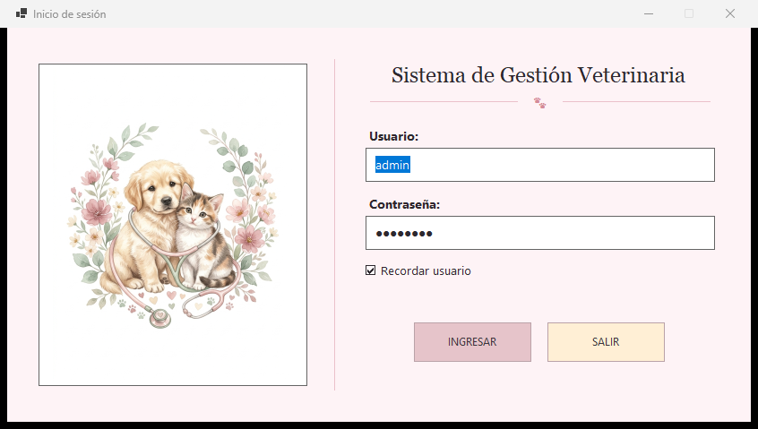
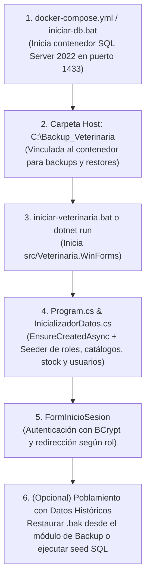

# Sistema de Gestión --- Clínica Veterinaria

Sistema integral de escritorio para la gestión clínica, administrativa y contable de una veterinaria, desarrollado sobre **.NET 10 (C# / Windows Forms)** y **Microsoft SQL Server 2022** (Docker). Implementa una arquitectura en N-Capas desacoplada con inyección de dependencias nativa, control transaccional de stock de insumos médicos, facturación de pago único con calculadora de vuelto y emisión de tickets térmicos, reportes analíticos con gráficos vectoriales GDI+ exportables a PDF, y resguardo/restauración de base de datos (`.bak`) bajo protocolo de **Doble Firma** (*Administrador* + *Gerente*).



---

## Documentación Oficial del Proyecto

El repositorio cuenta con la documentación técnica y operativa completa del sistema:

* **Especificación de Requisitos de Software (ERS v2.0):**
  * **Versión interactiva (Markdown):** [docs/ERS_v2.md](docs/ERS_v2.md)
  * **Versión editorial lista para imprimir (PDF A4 --- 9 páginas):** [docs/ERS_v2.pdf](docs/ERS_v2.pdf)
  * **Diagrama de Entidad-Relación (DER definitivo):** [docs/capturas/VeterinariaDb-DER.png](docs/capturas/VeterinariaDb-DER.png)
  * *Versión preliminar histórica de la cursada:* [docs/ERS_v1.pdf](docs/ERS_v1.pdf)
* **Manual de Usuario paso a paso por rol:**
  * **Versión interactiva (Markdown):** [MANUAL_USUARIO.md](MANUAL_USUARIO.md)
  * **Versión editorial lista para imprimir (PDF A4 --- 19 páginas):** [MANUAL_USUARIO.pdf](MANUAL_USUARIO.pdf)
  * **Galería de capturas del sistema:** [`docs/capturas/`](docs/capturas/)

---

## Índice

1. [Resumen de Módulos por Rol](#1-resumen-de-módulos-por-rol)
2. [Requisitos Previos](#2-requisitos-previos)
3. [Lanzamiento Rápido (Sin Visual Studio)](#3-lanzamiento-rápido-sin-visual-studio)
4. [Flujo y Orden de Ejecución](#4-flujo-y-orden-de-ejecución)
5. [Arquitectura del Proyecto](#5-arquitectura-del-proyecto)
6. [Credenciales de Acceso por Rol](#6-credenciales-de-acceso-por-rol)
7. [Configuración de Base de Datos y Conexión](#7-configuración-de-base-de-datos-y-conexión)
8. [Scripts y Archivos Clave del Repositorio](#8-scripts-y-archivos-clave-del-repositorio)

---

## 1. Resumen de Módulos por Rol

### A. Rol Administrador
* **Gestión de Usuarios y Perfiles:** Alta, modificación y baja lógica (`Activo` / `Inactivo`) del personal con contraseñas cifradas mediante `BCrypt` y protección contra auto-desactivación de la sesión activa.
* **Auditoría del Padrón de Propietarios y Mascotas:** Consulta global con buscadores combinados y vista maestro-detalle de las mascotas asociadas a cada titular.
* **Reportes Gerenciales:** Estadísticas por período con visualización dual (**Gráficos GDI+ de barras y anillo** o **Tabla**), filtros por veterinario/especie, impresión A4 y exportación directa a PDF.
* **Copias de Seguridad (`.bak`) y Restauración con Doble Firma:** Generación de respaldos físicos en `C:\Backup_Veterinaria` con historial de auditoría y restauración protegida mediante validación simultánea de credenciales de **Administrador** y **Gerente**.

### B. Rol Secretario (Recepción y Caja)
* **Gestión de Propietarios y Pacientes (Mascotas):** Empadronamiento de clientes y mascotas con selectores buscables en tiempo real y ventanas satélite para alta/edición rápida de **Especies** y **Razas**.
* **Caja y Gestión de Cobros:**
  * Desglose automático de los cargos de la atención (*Consulta base according a la especie*, *Tratamientos aplicados* y *Vacunas suministradas*).
  * **Pago único por el total:** Campo de importe bloqueado (solo lectura) para garantizar la integridad del cobro.
  * **Calculadora de vuelto en efectivo:** Habilitación automática del campo `Abona con ($)`, validación contra pagos insuficientes y cálculo en vivo del `Vuelto` en pantalla y en el comprobante.
  * Soporte para **Tarjeta de Crédito** (1, 3, 6 y 12 cuotas), **Tarjeta de Débito** y **Transferencia Bancaria**.
  * **Emisión de Ticket:** Generación e impresión de comprobante en formato térmico (80 mm) con opción de reimpresión desde el historial.
* **Reportes de Cobros:** Arqueo de recaudación por método de pago y evolución mensual exportable a PDF.

### C. Rol Veterinario (Atención Clínica)
* **Consultas Clínicas y Signos Vitales:**
  * Registro de motivo, diagnóstico, observaciones y fecha de próximo control.
  * **Validación asistida de rangos fisiológicos:** Subleyendas indicativas en rojo para **Peso** (`0,10 a 100,00 kg`) y **Temperatura** (`35,0 a 43,0 °C`) con limpieza preventiva de valores fuera de rango.
* **Aplicación de Tratamientos y Catálogo:** Asociación de prácticas e insumos a la consulta activa con descuento automático de stock; alta y modificación del catálogo con protección de inmutabilidad sobre el stock inicial.
* **Vacunación y Calendario de Dosis:** Registro de vacunas aplicadas (internas con descuento de stock o previas/externas sin costo) y programación de próximo refuerzo.
* **Ficha Médica / Historial Clínico Imprimible:** Vista integral del paciente que unifica consultas, signos vitales, tratamientos y vacunas en la columna **`Tratamiento / Vacunación`**, con alto de fila autoajustable tanto en pantalla como en la impresión A4 multi-línea.
* **Reportes Clínicos:** Estadísticas personales de consultas atendidas por mes, distribución por especie y aplicaciones de vacunas/tratamientos.

---

## 2. Requisitos Previos

Para compilar y ejecutar el proyecto no se requiere instalar Visual Studio completo; únicamente se necesita:

* **Sistema Operativo:** Windows 10 o Windows 11 (64-bit).
* **.NET SDK:** Versión **10.0** o superior ([Descargar .NET 10 SDK](https://dotnet.microsoft.com/download/dotnet/10.0)).
* **Motor de Base de Datos:**
  * **Opción recomendada:** [Docker Desktop para Windows](https://www.docker.com/products/docker-desktop/) (levanta SQL Server 2022 en un contenedor preconfigurado con un solo clic).
  * **Opción alternativa:** Instancia local de SQL Server escuchando en el puerto estándar `1433`.

---

## 3. Lanzamiento Rápido (Sin Visual Studio)

### Método 1: Lanzador automatizado (`.bat`) --- *Recomendado*
Hacer doble clic sobre el archivo en la raíz del repositorio:
```bat
iniciar-veterinaria.bat
```
Este script ejecuta automáticamente las siguientes tareas:
1. Verifica que el SDK de .NET 10 esté disponible en el equipo.
2. Crea la carpeta local `C:\Backup_Veterinaria` (utilizada para el mapeo de respaldos `.bak`).
3. Comprueba el estado de Docker e inicia el contenedor `mssql2022_veterinaria` si no se encuentra en ejecución.
4. Compila y lanza la aplicación WinForms mediante `dotnet run`.

### Método 2: Lanzamiento manual desde terminal (CLI)

1. **Iniciar el contenedor de base de datos:**
   ```cmd
   iniciar-db.bat
   ```
   *(o directamente `docker compose up -d`)*

2. **Compilar y ejecutar la aplicación:**
   ```cmd
   dotnet run --project src/Veterinaria.WinForms/Veterinaria.WinForms.csproj
   ```

3. **Detener la base de datos al finalizar:**
   ```cmd
   detener-db.bat
   ```

---

## 4. Flujo y Orden de Ejecución



### Poblamiento con Datos de Prueba (Opcional para Reportes y Gráficos)
Si desea contar de inmediato con un volumen histórico completo de propietarios, mascotas, consultas clínicas, vacunas, tratamientos y cobros:
1. Copie el archivo `backups/Backup_20261102_poblado_completo.bak` dentro de `C:\Backup_Veterinaria\`.
2. Inicie sesión como **Administrador** (`admin` / `admin123` o `lLOPEZ.ADM` / `123456`).
3. Ingrese al módulo **Backup**, seleccione el archivo `.bak` (o búsquelo con **`Examinar archivo .bak...`**) y presione **`Restaurar Copia`**.
4. Complete la autorización de **Doble Firma** con las credenciales de Administrador y del **Gerente**.

---

## 5. Arquitectura del Proyecto

El sistema sigue una **arquitectura en N-Capas desacoplada**, organizada bajo la carpeta `src/`:

```text
Veterinaria/
├── src/
│   ├── Veterinaria.Domain/           --> Entidades del dominio, DTOs y contratos
│   ├── Veterinaria.Infrastructure/   --> Contexto EF Core, configuración Fluent API, DDL y Seeder
│   ├── Veterinaria.Controllers/      --> Controladores de negocio, validaciones, stock y seguridad BCrypt
│   └── Veterinaria.WinForms/         --> Vistas Windows Forms por rol, impresión GDI+ y controles custom
├── docs/
│   └── capturas/                     --> 18 capturas de pantalla reales del sistema (01 a 18)
├── backups/                          --> Copias de seguridad (.bak) con datos de prueba hidratados
├── scripts/                          --> Scripts SQL de sembrado orgánico para reportes
├── MANUAL_USUARIO.md                 --> Manual de usuario paso a paso en formato Markdown
├── MANUAL_USUARIO.pdf                --> Manual de usuario maquetado en formato PDF (A4)
├── docker-compose.yml                --> Definición del contenedor SQL Server 2022
├── iniciar-veterinaria.bat           --> Lanzador integral de la solución
├── iniciar-db.bat                    --> Script de inicio del contenedor de base de datos
└── detener-db.bat                    --> Script de detención del contenedor de base de datos
```

### Responsabilidades por capa:
* **`Veterinaria.Domain`:** Contiene las entidades persistentes (`Usuario`, `TipoUsuario`, `Propietario`, `Mascota`, `Especie`, `Raza`, `Consulta`, `Tratamiento`, `DetalleConsulta`, `Vacuna`, `AplicacionVacuna`, `Pago`, `MetodoPago`, `Backup`) y los DTOs tipados de transferencia entre capas.
* **`Veterinaria.Infrastructure`:** Gestiona la persistencia con Entity Framework Core (`ContextoVeterinaria`), migraciones de columnas en caliente, procedimientos almacenados de reportes (`ObjetosBaseDatos.cs`) y el sembrado inicial (`InicializadorDatos.cs`).
* **`Veterinaria.Controllers`:** Implementa las reglas de negocio:
  * Control transaccional de inventario al aplicar tratamientos y vacunas, e inmutabilidad del stock inicial en la edición de catálogos.
  * Consolidación de tratamientos y vacunas en el historial clínico de cada mascota.
  * Regla de cobro único por el importe total de la consulta.
  * Generación y restauración de backups SQL Server con validación de doble firma.
* **`Veterinaria.WinForms`:** Capa de presentación construida con inyección de dependencias (`Microsoft.Extensions.DependencyInjection`), controles personalizados (`ComboBuscable`, `GraficoReporte`, `SelectorVistaReporte`) y motores de impresión GDI+ para tickets térmicos, fichas médicas multi-línea y reportes estadísticos.

---

## 6. Credenciales de Acceso por Rol

El sistema dispone de cuentas iniciales sembradas automáticamente y cuentas adicionales en el set de datos poblado:

| Rol | Usuario | Contraseña | Origen | Alcance Operativo |
| :--- | :--- | :--- | :--- | :--- |
| **Administrador** | `admin` | `admin123` | Seeder base | Acceso total, ABM de usuarios, padrones, reportes y backups. |
| **Administrador** | `lLOPEZ.ADM` | `123456` | Base poblada | Administradora general del set de datos histórico. |
| **Veterinario** | `vet` | `vet123` | Seeder base | Consultas, signos vitales, tratamientos, vacunas, ficha médica y reportes. |
| **Veterinario** | `MROGRIGUEZ.VET` | `123456` | Base poblada | Veterinario clínico con historial de consultas precargado. |
| **Secretario** | `secretario` | `sec123` | Seeder base | Recepción de propietarios y mascotas, cobros, vuelto, tickets y reportes. |
| **Secretario** | `cMORALES.SEC` | `123456` | Base poblada | Operador de recepción y caja del set de datos histórico. |
| **Gerente** | `gerente` | `gerente123` | Seeder base | Rol autorizador (segunda firma en operaciones de Backup / Restore). |

---

## 7. Configuración de Base de Datos y Conexión

La cadena de conexión principal se lee desde [src/Veterinaria.WinForms/appsettings.json](src/Veterinaria.WinForms/appsettings.json):

```json
{
  "ConnectionStrings": {
    "DefaultConnection": "Server=localhost,1433;Database=VeterinariaDb;User Id=sa;Password=Pass123456!;TrustServerCertificate=True;MultipleActiveResultSets=true;"
  }
}
```

En caso de no encontrarse el archivo `appsettings.json`, `Program.cs` utiliza automáticamente esta misma cadena de conexión como respaldo por defecto apuntando al contenedor local en `localhost,1433`.

---

## 8. Scripts y Archivos Clave del Repositorio

* **[docs/ERS_v2.md](docs/ERS_v2.md) / [docs/ERS_v2.pdf](docs/ERS_v2.pdf):** Especificación formal de requisitos de software actualizada a la versión 2.0 (38 RF, 18 RNF, Casos de Uso y DER definitivo de 15 tablas).
* **[MANUAL_USUARIO.md](MANUAL_USUARIO.md) / [MANUAL_USUARIO.pdf](MANUAL_USUARIO.pdf):** Guía completa de operación paso a paso dividida por rol con las 18 pantallas del sistema.
* **`iniciar-veterinaria.bat`:** Script principal de arranque automático (Docker + compilación + ejecución).
* **`iniciar-db.bat` / `detener-db.bat`:** Administración rápida del contenedor `mssql2022_veterinaria`.
* **`docker-compose.yml`:** Configuración de SQL Server 2022 con volumen de datos persistente y carpeta compartida `C:/Backup_Veterinaria:/var/opt/mssql/backup`.
* **`backups/Backup_20261102_poblado_completo.bak`:** Copia de seguridad con datos históricos completos para pruebas de estrés, reportes y gráficos.
* **`scripts/seed_organico_reportes.sql`:** Script T-SQL para generación masiva de datos clínicos y contables.
* **`Credenciales-login.txt`:** Referencia rápida de usuarios del lote poblado.
