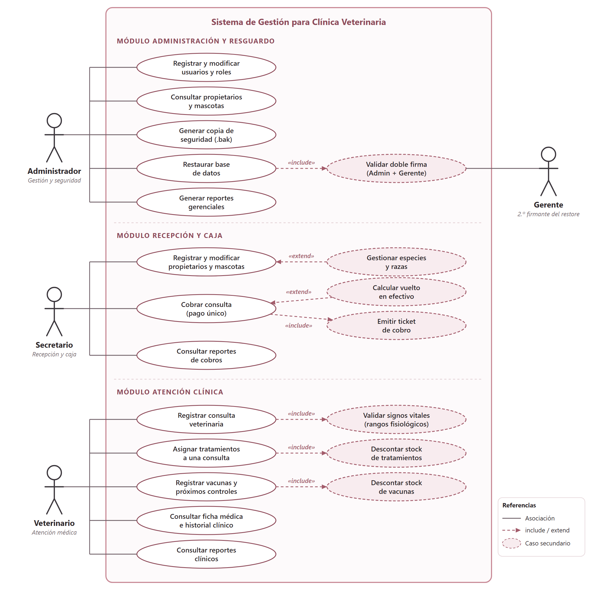
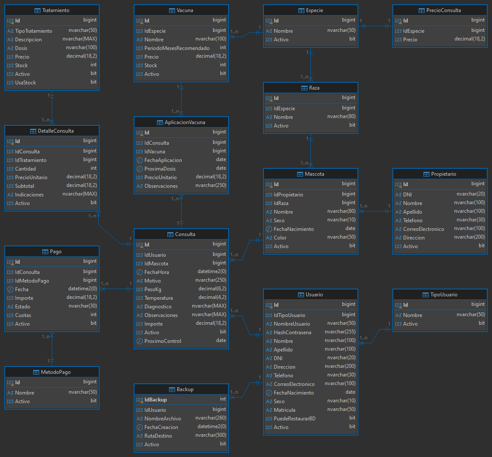

# Especificación de Requisitos de Software (ERS) --- Versión 2.0

> **Proyecto:** Sistema de escritorio para una veterinaria  
> **Integrantes:** Mormina Daniela, Nazer Nair  
> **Versión:** 2.0 --- actualiza la [ERS v1](ERS_v1.pdf) (inicio de la cursada) al estado final del sistema  
> **Plataforma:** Windows Desktop (.NET 10 Windows Forms) + Microsoft SQL Server 2022 (Docker)  
> **Fecha:** Noviembre 2026

---

## Índice

1. [Introducción y propósito](#1-introducción-y-propósito)
2. [Alcance del producto](#2-alcance-del-producto)
3. [Perfiles de usuario](#3-perfiles-de-usuario)
4. [Requisitos funcionales (RF01 --- RF38)](#4-requisitos-funcionales-rf01-----rf38)
5. [Requisitos no funcionales (RNF01 --- RNF18)](#5-requisitos-no-funcionales-rnf01-----rnf18)
6. [Diagrama de casos de uso](#6-diagrama-de-casos-de-uso)
7. [Diagrama de entidad-relación](#7-diagrama-de-entidad-relación)
8. [Trazabilidad y cambios respecto de la v1](#8-trazabilidad-y-cambios-respecto-de-la-v1)

---

## 1. Introducción y propósito

Este documento actualiza la ERS que se presentó antes de empezar el proyecto ([ERS_v1.pdf](ERS_v1.pdf), con 30 requisitos funcionales y 15 no funcionales) para que describa el sistema **tal como quedó construido y probado**. Se mantienen la estructura y la intención de la v1 (mismo tipo de requisitos, mismo diagrama de casos de uso por actor y mismo DER como base) y se incorporan las decisiones tomadas durante el desarrollo y el ciclo de pruebas.

**Convención de numeración.** Los requisitos de la v2 están **renumerados**: RF01 a RF38 y RNF01 a RNF18 no coinciden uno a uno con los de la v1. La [sección 8](#8-trazabilidad-y-cambios-respecto-de-la-v1) incluye la tabla que relaciona cada requisito de la v1 con su equivalente en la v2 e indica cuáles son nuevos.

---

## 2. Alcance del producto

El sistema cubre el trabajo diario de la veterinaria en tres frentes:

1. **Recepción y caja:** alta de propietarios y mascotas, catálogo de especies y razas, cobro de consultas y emisión del ticket.
2. **Atención clínica:** registro de consultas con signos vitales, tratamientos y vacunas con control de stock, ficha médica e historial clínico.
3. **Administración y seguridad:** usuarios y perfiles, reportes con gráficos, copias de seguridad y restauración protegida por doble autorización.

**Se mantiene fuera de alcance** la gestión de turnos (igual que en la v1).

**Cambio respecto de la v1:** la v1 indicaba que el Veterinario representaba al único profesional de la veterinaria. En la v2 el sistema admite **varios usuarios con perfil Veterinario**: cada consulta registra al profesional que la atendió y los reportes del Administrador pueden filtrarse por veterinario.

---

## 3. Perfiles de usuario

El acceso está restringido por perfil (tabla `TipoUsuario`). La v1 definía tres perfiles; la v2 agrega el **Gerente**.

| Perfil | Pantalla propia | Responsabilidades |
| :--- | :--- | :--- |
| **Administrador** | Sí | Usuarios y perfiles, consulta de propietarios y mascotas, reportes gerenciales, copias de seguridad e inicio de la restauración. |
| **Secretario** | Sí | Propietarios y mascotas, especies y razas, cobro de consultas, ticket y reportes de cobros. |
| **Veterinario** | Sí | Consultas y signos vitales, tratamientos, vacunas, ficha médica e historial, reportes clínicos. |
| **Gerente** | No | No opera el sistema. Su contraseña se solicita como **segunda autorización** al restaurar una copia de seguridad. |

---

## 4. Requisitos funcionales (RF01 --- RF38)

### 4.1. Usuarios y seguridad

* **RF01. Inicio de sesión:** el sistema deberá permitir iniciar sesión con nombre de usuario y contraseña, con la opción de recordar el usuario en el equipo.
* **RF02. Control por tipo de usuario:** el sistema deberá abrir únicamente el panel y las funciones que corresponden al perfil del usuario (Administrador, Secretario o Veterinario).
* **RF03. Registro de usuarios:** el Administrador deberá poder registrar usuarios con sus datos personales (nombre, apellido, DNI único, dirección, teléfono, correo, fecha de nacimiento y sexo), usuario único, contraseña y perfil.
* **RF04. Consulta, modificación y baja lógica de usuarios:** el Administrador deberá poder consultar y modificar usuarios, cambiar su perfil y activarlos o desactivarlos.
* **RF05. Protección de la sesión activa:** el sistema no deberá permitir que un usuario desactive su propia cuenta mientras tiene la sesión abierta.
* **RF06. Permiso de restauración:** el atributo `PuedeRestaurarBD` del usuario determinará si puede iniciar una restauración de la base de datos.

### 4.2. Propietarios, mascotas, especies y razas

* **RF07. Registro de propietarios:** el sistema deberá permitir registrar propietarios con DNI único, nombre, apellido, teléfono, correo y dirección.
* **RF08. Consulta, modificación y baja lógica de propietarios:** el sistema deberá permitir buscar, modificar y activar o desactivar propietarios.
* **RF09. Registro de mascotas:** el sistema deberá permitir registrar mascotas asociadas a un propietario y a una raza (que determina su especie), con nombre, sexo, color y fecha de nacimiento.
* **RF10. Asociación mascota-propietario:** cada mascota pertenece a un propietario y un propietario puede tener una o varias mascotas.
* **RF11. Especies y razas:** el sistema deberá permitir dar de alta y modificar especies y las razas de cada especie, incluso desde la pantalla de mascotas.
* **RF12. Razas por especie:** al elegir una especie, el sistema deberá ofrecer solo las razas de esa especie.
* **RF13. Consulta, modificación y baja lógica de mascotas:** el sistema deberá permitir buscar, modificar y activar o desactivar mascotas.

### 4.3. Consultas veterinarias y ficha médica

* **RF14. Registro de consultas:** el Veterinario deberá poder registrar una consulta de una mascota con fecha y hora, motivo, peso, temperatura, diagnóstico y observaciones; la consulta queda asociada al profesional que la atendió.
* **RF15. Importe de consulta por especie:** el sistema deberá proponer automáticamente el importe de la consulta según la especie de la mascota (tabla `PrecioConsulta`).
* **RF16. Validación de signos vitales:** el sistema deberá aceptar únicamente peso entre **0,10 y 100,00 kg** y temperatura entre **35,0 y 43,0 °C**. Debajo de cada campo se mostrará el rango aceptado en color rojo y, si el valor está fuera de rango, el campo se limpiará al abandonarlo.
* **RF17. Próximo control:** el Veterinario podrá registrar la fecha recomendada del próximo control.
* **RF18. Ficha médica e historial clínico:** el sistema deberá mostrar los datos de la mascota y su historial cronológico de consultas, incluyendo en una misma columna (**Tratamiento / Vacunación**) los tratamientos y las vacunas de cada atención.
* **RF19. Visualización e impresión de la ficha:** las filas del historial deberán ajustar su alto para mostrar el texto completo, tanto en pantalla como en la impresión de la ficha.

### 4.4. Tratamientos, vacunas y stock

* **RF20. Catálogo de tratamientos:** el sistema deberá permitir registrar tratamientos con tipo, descripción, dosis, precio, stock, indicador de uso de stock y estado.
* **RF21. Stock inicial no editable:** al modificar un tratamiento existente, el stock no deberá poder editarse.
* **RF22. Tratamientos en la consulta:** el Veterinario deberá poder asociar uno o varios tratamientos a una consulta (detalle de consulta) indicando cantidad e indicaciones; el sistema guarda el precio unitario y calcula el subtotal como cantidad por precio unitario.
* **RF23. Descuento de stock de tratamientos:** al aplicar un tratamiento que usa stock, el sistema deberá verificar que haya existencias y descontarlas.
* **RF24. Catálogo de vacunas:** el sistema deberá permitir registrar vacunas con especie, nombre, período recomendado en meses, precio, stock y estado.
* **RF25. Aplicación de vacunas:** el Veterinario deberá poder registrar la aplicación de una vacuna indicando fecha, próxima dosis y observaciones; el sistema guarda el precio aplicado y descuenta una unidad de stock.
* **RF26. Vacunas previas o externas:** el sistema deberá permitir registrar una vacuna aplicada fuera de la veterinaria, sin precio y sin descontar stock.

### 4.5. Cobros

* **RF27. Consultas a cobrar:** el Secretario deberá poder seleccionar la consulta que va a cobrar y ver el detalle de su importe (consulta, tratamientos y vacunas).
* **RF28. Importe total:** el sistema deberá calcular el total sumando el importe de la consulta, los tratamientos aplicados y las vacunas aplicadas.
* **RF29. Pago único:** cada consulta se cobra en **un solo pago por el total**. El campo de importe se muestra bloqueado y no puede modificarse.
* **RF30. Medios de pago:** el sistema deberá admitir Efectivo, Tarjeta de Débito, Tarjeta de Crédito (1 pago, 3, 6, 9 o 12 cuotas) y Transferencia Bancaria.
* **RF31. Vuelto en efectivo:** al pagar en efectivo, el sistema deberá pedir con cuánto abona el cliente, exigir que sea igual o mayor al total y calcular el vuelto.
* **RF32. Ticket de cobro:** al registrar el pago, el sistema deberá generar un ticket con el detalle del cobro (incluidos el monto recibido y el vuelto en pagos en efectivo), que podrá imprimirse y volver a imprimirse desde el historial.

### 4.6. Reportes

* **RF33. Gráficos y tablas:** los reportes deberán poder verse como gráfico (barras de evolución por período y gráfico de anillo) o como tabla, con agrupación por período.
* **RF34. Reportes por perfil:**
  * **Administrador:** consultas con tratamientos y vacunas (filtrable por veterinario y especie), censo de animales y propietarios, y total de pagos.
  * **Secretario:** cobros del período por método de pago y por mes.
  * **Veterinario:** sus consultas, y vacunas y tratamientos aplicados.
* **RF35. Impresión y PDF:** todos los reportes deberán poder imprimirse y exportarse a PDF.

### 4.7. Copias de seguridad

* **RF36. Copia de seguridad:** el Administrador deberá poder generar una copia completa de la base de datos (archivo `.bak`) con nombre propuesto por fecha y hora.
* **RF37. Historial de copias:** cada copia generada deberá registrarse con nombre de archivo, ruta, fecha y hora, y usuario que la realizó.
* **RF38. Restauración con doble autorización:** para restaurar una copia, el sistema deberá validar **(1)** que el administrador en sesión tenga `PuedeRestaurarBD` y confirme su contraseña, y **(2)** la contraseña de un usuario activo con perfil **Gerente**.

---

## 5. Requisitos no funcionales (RNF01 --- RNF18)

| Código | Atributo | Requisito |
| :--- | :--- | :--- |
| **RNF01** | Seguridad de acceso | Toda función requiere autenticación previa; las cuentas inactivas no pueden ingresar. |
| **RNF02** | Seguridad de contraseñas | En la base de datos las contraseñas se almacenan con hash (BCrypt), nunca como texto plano. |
| **RNF03** | Autorización | Cada usuario solo accede a las funciones de su perfil. |
| **RNF04** | Integridad de datos | SQL Server utiliza claves primarias y foráneas, restricciones e índices únicos; las operaciones que modifican varias tablas (por ejemplo, aplicar una vacuna y descontar su stock) se guardan juntas. |
| **RNF05** | Persistencia | La información se conserva al cerrar la aplicación; la base corre en un contenedor Docker con volumen persistente y una carpeta del equipo compartida para las copias `.bak`. |
| **RNF06** | Manejo de errores | Las excepciones se controlan para evitar cierres inesperados o registros incompletos; la conexión a la base reintenta ante fallos transitorios y el cursor de espera siempre se restablece. |
| **RNF07** | Mensajes claros | Los mensajes al usuario son comprensibles y no exponen errores técnicos internos. |
| **RNF08** | Usabilidad | La interfaz es sencilla y uniforme (misma paleta y estructura en todas las pantallas), con listas desplegables buscables. |
| **RNF09** | Rendimiento | Las operaciones habituales responden sin demoras perceptibles en condiciones normales. |
| **RNF10** | Mantenibilidad | El código separa dominio, infraestructura, lógica de negocio y presentación en cuatro proyectos (`Domain`, `Infrastructure`, `Controllers`, `WinForms`) con inyección de dependencias. |
| **RNF11** | Base de datos | Se utiliza SQL Server 2022 con procedimientos almacenados para reportes. |
| **RNF12** | Despliegue | La base se levanta con Docker Compose y la aplicación se compila y ejecuta con el SDK de .NET mediante los lanzadores `.bat`, sin necesidad de Visual Studio. |
| **RNF13** | Control de versiones | El proyecto se versiona con Git, excluyendo binarios y archivos temporales. |
| **RNF14** | Compatibilidad | La aplicación se ejecuta en Windows 10 y 11 y se conecta a SQL Server. |
| **RNF15** | Información histórica | Consultas, detalles, tratamientos, vacunas y pagos históricos se conservan; las bajas son lógicas (`Activo = 0`). |
| **RNF16** | Gráficos e impresión | Los gráficos, tickets, fichas y reportes se dibujan con `System.Drawing` (GDI+), sin librerías externas de reportes. |
| **RNF17** | Restauración segura | Al restaurar, la base pasa temporalmente a modo de usuario único (se desconectan las demás sesiones), se restaura con reemplazo y se vuelve a modo multiusuario. |
| **RNF18** | Pruebas | Las funciones principales se probaron con casos válidos e inválidos mediante un plan de QA por fases. |

---

## 6. Diagrama de casos de uso

El diagrama sigue el esquema de la v1 (un actor por perfil con sus casos de uso) y suma el actor **Gerente**, la agrupación por módulo y las relaciones `«include»` y `«extend»` surgidas durante el desarrollo.

| Actor | Casos de uso principales |
| :--- | :--- |
| **Administrador** | Registrar y modificar usuarios y roles; consultar propietarios y mascotas; generar copia de seguridad; restaurar base de datos (incluye *Validar doble firma*); generar reportes gerenciales. |
| **Secretario** | Registrar y modificar propietarios y mascotas (extendido por *Gestionar especies y razas*); cobrar consulta (extendido por *Calcular vuelto*, incluye *Emitir ticket*); consultar reportes de cobros. |
| **Veterinario** | Registrar consulta (incluye *Validar signos vitales*); asignar tratamientos (incluye *Descontar stock*); registrar vacunas y próximos controles (incluye *Descontar stock*); consultar ficha médica e historial; consultar reportes clínicos. |
| **Gerente** | Participa solo en *Validar doble firma*, como segunda autorización de la restauración. |

> Todos los actores deben iniciar sesión antes de operar (RF01). Para no saturar el diagrama no se dibuja ese caso de uso común.

---

## 7. Diagrama de entidad-relación

Modelo actual de la base `VeterinariaDb`, con 15 tablas:

| Grupo | Tablas |
| :--- | :--- |
| Usuarios y seguridad | `Usuario`, `TipoUsuario`, `Backup` |
| Propietarios y mascotas | `Propietario`, `Mascota`, `Especie`, `Raza`, `PrecioConsulta` |
| Atención clínica | `Consulta`, `DetalleConsulta`, `Tratamiento` |
| Vacunación | `Vacuna`, `AplicacionVacuna` |
| Cobros | `Pago`, `MetodoPago` |

Relaciones principales: `TipoUsuario` - `Usuario` - `Consulta` - `DetalleConsulta` - `Tratamiento`; `Consulta` - `AplicacionVacuna` - `Vacuna`; `Propietario` - `Mascota` - `Consulta`; `Especie` - `Raza` - `Mascota`; `Especie` - `PrecioConsulta`; `Especie` - `Vacuna`; `Consulta` - `Pago` - `MetodoPago`; `Usuario` - `Backup`.

---

## 8. Trazabilidad y cambios respecto de la v1

### 8.1. Requisitos funcionales de la v1

| RF de la v1 | Requisito | Equivalente en la v2 | Estado |
| :--- | :--- | :--- | :--- |
| RF01 | Inicio de sesión | RF01 | Se mantiene (agrega recordar usuario) |
| RF02 | Control por tipo de usuario | RF02 | Se mantiene (agrega el perfil Gerente) |
| RF03 | Registro de usuarios | RF03 | Se mantiene |
| RF04 | Modificación y baja de usuarios | RF04, RF05 | Se mantiene (agrega protección de la sesión activa) |
| RF05 | Asignación del tipo de usuario | RF03, RF04 | Integrado |
| RF06 | Registro de propietarios | RF07 | Se mantiene; lo pueden usar Secretario y Administrador |
| RF07 | Modificación y baja de propietarios | RF08 | Se mantiene |
| RF08 | Registro de mascotas | RF09 | Se mantiene |
| RF09 | Modificación y baja de mascotas | RF13 | Se mantiene |
| RF10 | Asociación mascota-propietario | RF10 | Se mantiene |
| RF11 | Asociación mascota-especie | RF09, RF12 | Integrado (la especie se obtiene por la raza) |
| RF12 | Registro de especies y razas | RF11, RF12 | Se mantiene (alta desde la pantalla de mascotas) |
| RF13 | Registro de consultas | RF14 | Se mantiene |
| RF14 | Datos de la consulta | RF14, RF16 | Se mantiene (agrega validación de rangos) |
| RF15 | Ficha médica | RF18 | Se mantiene |
| RF16 | Historial clínico | RF18, RF19 | Se mantiene (unifica tratamientos y vacunas) |
| RF17 | Registro de tratamientos | RF20, RF21 | Se mantiene (agrega stock) |
| RF18 | Detalle de la consulta | RF22 | Se mantiene |
| RF19 | Precio del tratamiento aplicado | RF22 | Se mantiene |
| RF20 | Cálculo del subtotal | RF22, RF28 | Se mantiene |
| RF21 | Registro de vacunas | RF24 | Se mantiene (agrega especie y stock) |
| RF22 | Aplicación de vacunas | RF25, RF26 | Se mantiene (agrega descuento de stock y vacunas externas) |
| RF23 | Próximo control | RF17 | Se mantiene |
| RF24 | Registro de pagos (uno o varios) | RF29, RF30 | **Cambia:** pago único por el total |
| RF25 | Datos del pago | RF30, RF31 | Se mantiene (agrega cuotas y vuelto) |
| RF26 | Consulta de pagos | RF27, RF34 | Cubierto por el detalle de cobros y los reportes de cobros por período |
| RF27 | Bajas lógicas | RF04, RF08, RF13, RNF15 | Se mantiene |
| RF28 | Validaciones | RF03, RF07, RF16, RF29, RF31 | Se mantiene (transversal, con reglas nuevas) |
| RF29 | Búsquedas y filtros | RF08, RF13 y listados de usuarios, propietarios y mascotas | Se mantiene |
| RF30 | Reportes | RF33, RF34, RF35 | Se mantiene (agrega gráficos, impresión y PDF) |

**Requisitos nuevos en la v2** (sin equivalente en la v1): RF05 (protección de sesión), RF06 (permiso de restauración), RF15 (importe por especie), RF16 (rangos de signos vitales), RF21 (stock no editable), RF23 (descuento de stock de tratamientos), RF26 (vacunas externas), RF27 y RF28 (bandeja e importe total), RF29 (pago único), RF31 (vuelto), RF32 (ticket), RF36, RF37 y RF38 (copias de seguridad y restauración).

### 8.2. Requisitos no funcionales de la v1

| RNF de la v1 | Equivalente en la v2 | Estado |
| :--- | :--- | :--- |
| RNF01 a RNF03 (acceso, contraseñas, autorización) | RNF01, RNF02, RNF03 | Se mantienen |
| RNF04 (integridad de datos) | RNF04 | Se mantiene (agrega transacciones) |
| RNF05 (persistencia) | RNF05 | Se mantiene (agrega contenedor y volumen) |
| RNF06 (manejo de errores) | RNF06 | Se mantiene |
| RNF07 (mensajes claros) | RNF07 | Se mantiene |
| RNF08 (usabilidad) | RNF08 | Se mantiene |
| RNF09 (rendimiento) | RNF09 | Se mantiene |
| RNF10 (mantenibilidad) | RNF10 | Se mantiene (cuatro proyectos e inyección de dependencias) |
| RNF11 (base de datos) | RNF11 | Se mantiene |
| RNF12 (control de versiones) | RNF13 | Se mantiene |
| RNF13 (pruebas) | RNF18 | Se mantiene (ejecutado mediante el plan de QA) |
| RNF14 (compatibilidad) | RNF14 | Se mantiene |
| RNF15 (información histórica) | RNF15 | Se mantiene |

**Nuevos en la v2:** RNF12 (despliegue con Docker y lanzadores), RNF16 (gráficos e impresión con GDI+) y RNF17 (restauración segura).

### 8.3. Resumen de cambios de diseño

| Tema | ERS v1 | ERS v2 |
| :--- | :--- | :--- |
| Perfiles | Administrador, Veterinario, Secretario | Se suma el **Gerente** (segunda autorización de restauraciones) |
| Profesionales | Un único Veterinario | Varios usuarios con perfil Veterinario |
| Pagos | Uno o varios pagos por consulta | **Pago único** por el total, importe bloqueado, vuelto en efectivo y cuotas con tarjeta |
| Inventario | No contemplado | Stock en tratamientos y vacunas, con descuento automático |
| Importe de la consulta | No contemplado (solo tratamientos y vacunas) | Importe por especie (`PrecioConsulta`) |
| Signos vitales | Peso y temperatura como datos de la consulta | Con rangos validados y leyenda del rango aceptado |
| Historial | Consultas en orden cronológico | Incluye tratamientos y vacunas en la misma tabla, con filas de alto ajustable |
| Reportes | Historial, tratamientos, vacunas e ingresos | Gráficos de barras y anillo, vista de tabla, impresión y exportación a PDF |
| Resguardo | No contemplado | Copias `.bak` con historial y restauración con doble autorización |
| Base de datos | 13 entidades principales | 15 tablas (se agregan `PrecioConsulta` y `Backup`) |

---

*Documento sincronizado con el repositorio y con el código fuente del sistema.*
